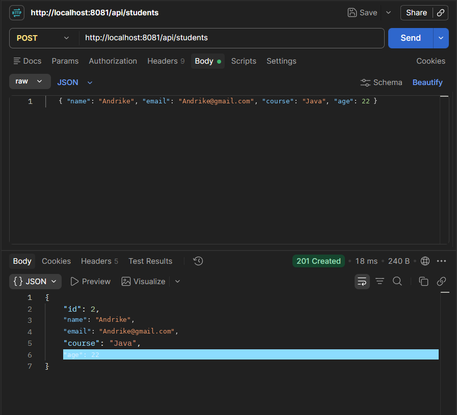
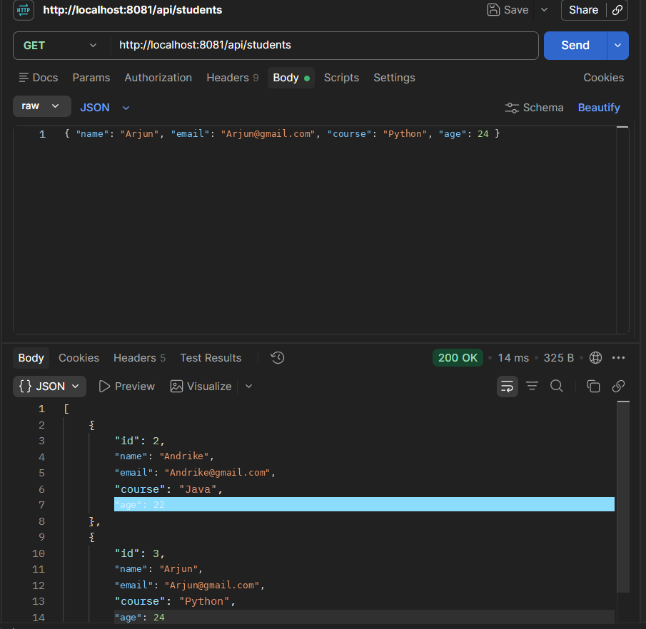
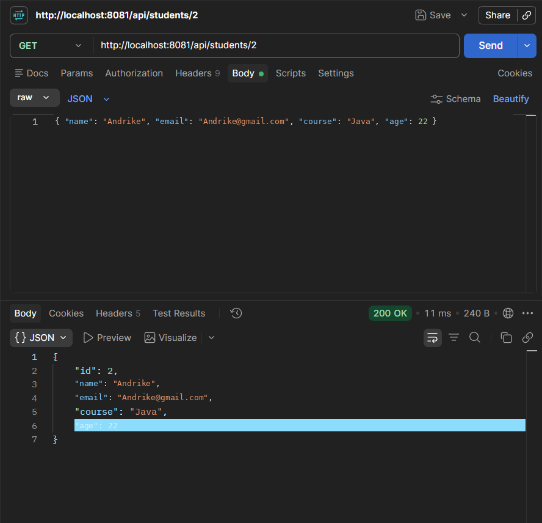
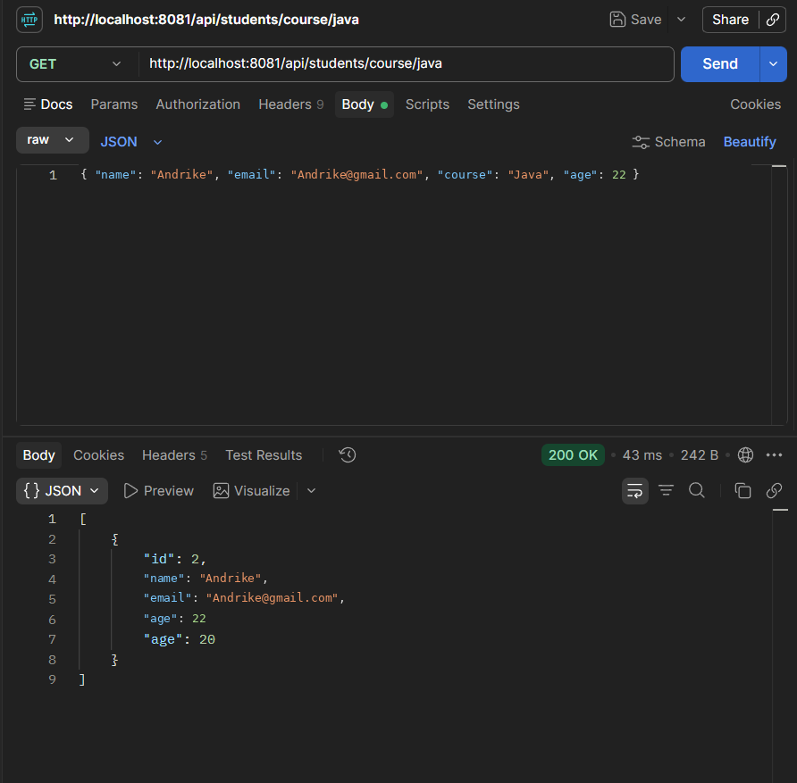
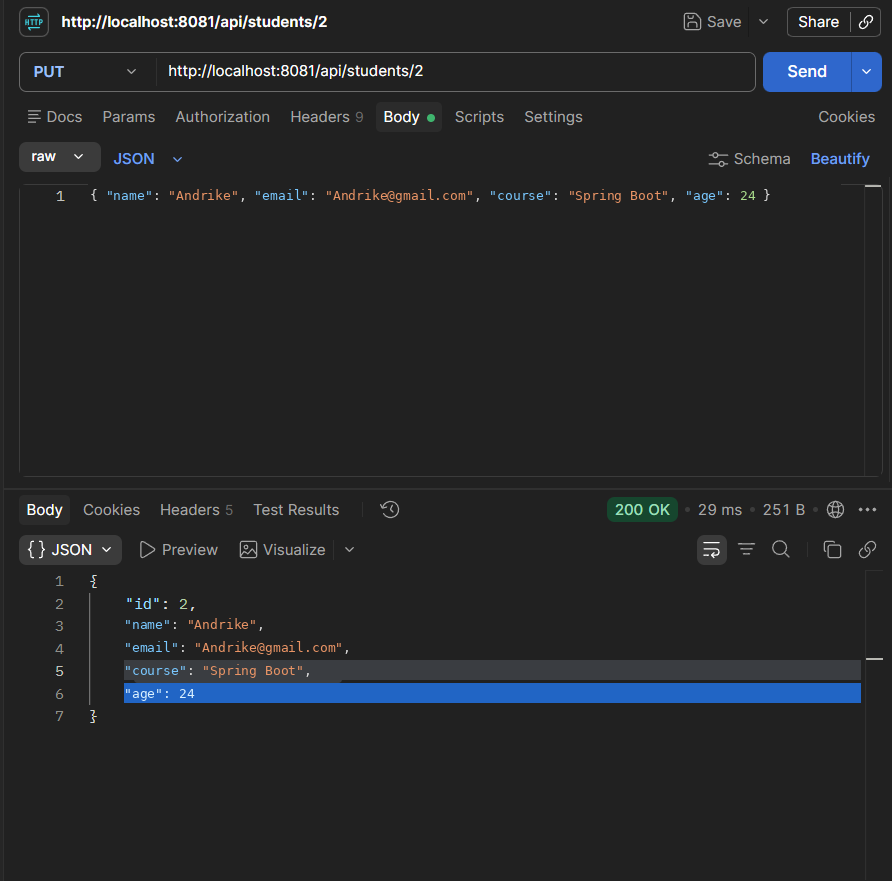
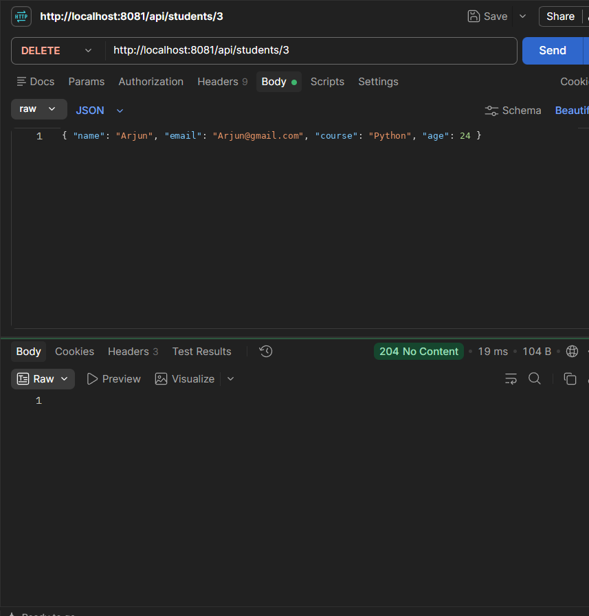
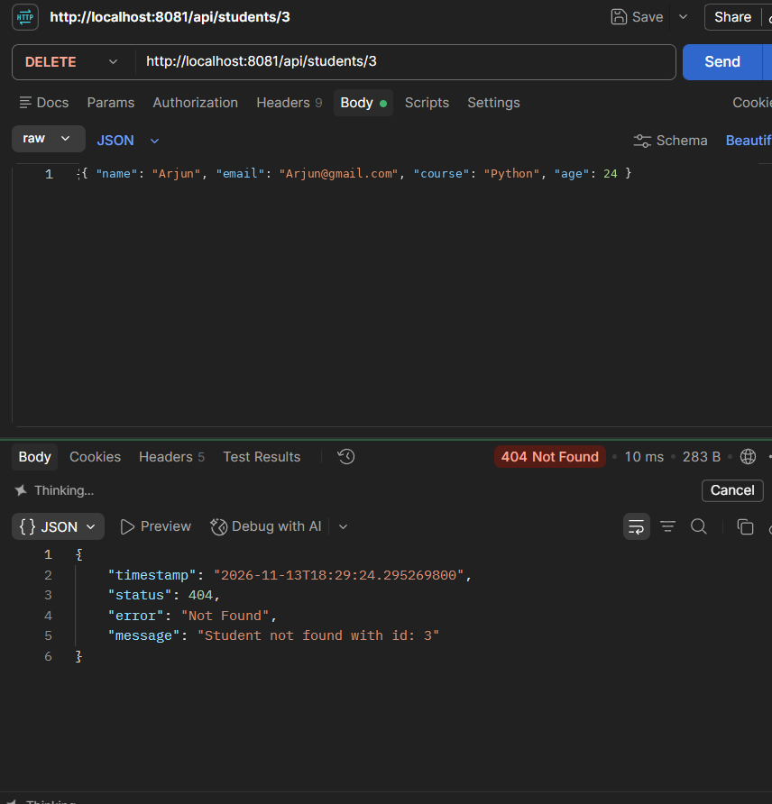
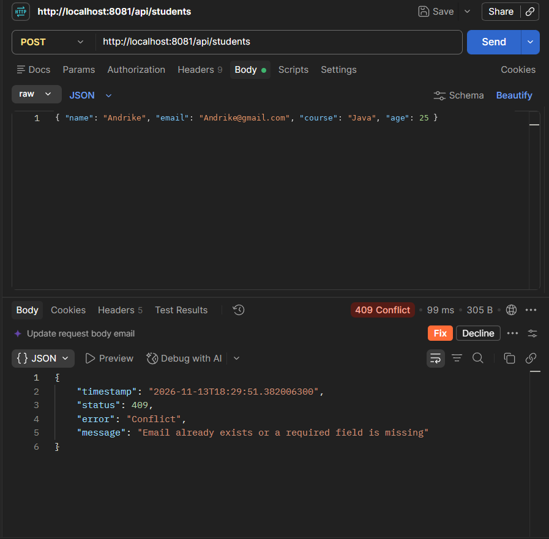

# Student Management System REST API

A **Spring Boot REST API** to create, view, update, delete, and search student records using **Spring Data JPA** and **MySQL**.

## Tech Stack

Java 17 · Spring Boot 3.3.5 · Spring Web · Spring Data JPA / Hibernate · MySQL · Maven · Postman

## Student Entity

| Field | Type | Description |
| --- | --- | --- |
| `id` | `Long` | Auto-generated primary key |
| `name` | `String` | Student name |
| `email` | `String` | Unique email address |
| `course` | `String` | Enrolled course |
| `age` | `Integer` | Student age |

## REST API Endpoints

**Base URL:** `http://localhost:8081/api/students`

| Method | Endpoint | Function | Success |
| --- | --- | --- | --- |
| `POST` | `/api/students` | Create student | `201 Created` |
| `GET` | `/api/students` | Get all students | `200 OK` |
| `GET` | `/api/students/{id}` | Get student by ID | `200 OK` |
| `GET` | `/api/students/course/{course}` | Search by course | `200 OK` |
| `PUT` | `/api/students/{id}` | Update student | `200 OK` |
| `DELETE` | `/api/students/{id}` | Delete student | `204 No Content` |

Missing students return **404 Not Found**; a duplicate email can return **409 Conflict**.

## Database Configuration

The project connects to **MySQL** on `localhost:3306` and uses the **`student_db`** database. Key settings in `src/main/resources/application.properties`:

```properties
server.port=8081
spring.datasource.url=jdbc:mysql://localhost:3306/student_db?createDatabaseIfNotExist=true&useSSL=false&allowPublicKeyRetrieval=true&serverTimezone=UTC
spring.jpa.hibernate.ddl-auto=update
spring.jpa.show-sql=true
```

Configure your local database connection settings in `application.properties` before running the project.

## Running the Project

1. Install **Java 17**, **Maven**, and **MySQL**, then start MySQL.
2. Configure the MySQL connection in `src/main/resources/application.properties`.
3. In the folder containing `pom.xml`, run:

   ```bash
   mvn spring-boot:run
   ```

4. Test the API in **Postman** at `http://localhost:8081/api/students`.

## Example JSON Request

Use this body with `POST /api/students` (Postman → Body → raw → JSON):

```json
{
  "name": "Andrike",
  "email": "Andrike@gmail.com",
  "course": "Java",
  "age": 22
}
```

More example request bodies are available in [`postman_examples/`](postman_examples/).

## Postman Screenshots

The images below demonstrate the API features and example error responses.

### 1. Create Student — POST (201)


### 2. Get All Students — GET (200)


### 3. Get Student by ID — GET (200)


### 4. Get Students by Course — GET (200)


### 5. Update Student — PUT (200)


### 6. Delete Student — DELETE (204)


### 7. Student Not Found — DELETE (404)


### 8. Duplicate Email — POST (409)


## Main Project Files

- `controller/StudentController.java` — REST endpoints
- `service/StudentService.java` — CRUD logic
- `repository/StudentRepository.java` — Database queries
- `entity/Student.java` — Student entity
- `exception/GlobalExceptionHandler.java` — API error handling
- `src/main/resources/application.properties` — Application settings

---
**Java / Spring Boot / MySQL — Student Management REST API Assignment**
